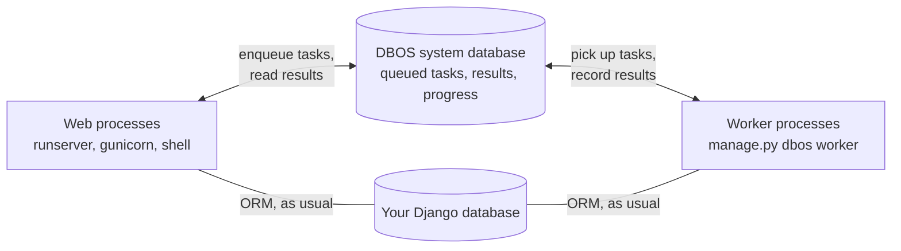

# django-dbos

**DBOS-backed backend for [Django's tasks framework](https://docs.djangoproject.com/en/stable/topics/tasks/)**:
durable background tasks, cron scheduling and optional Sentry monitoring.

```python
from django.tasks import task


@task
def send_welcome_email(user_id: int): ...


result = send_welcome_email.enqueue(user_id)  # durable, survives crashes
```

If you know [Django's tasks API](https://docs.djangoproject.com/en/stable/ref/tasks/), you already
know django-dbos: tasks are declared with `@task`, enqueued with `.enqueue()`, and results are
standard `TaskResult` objects. Under the hood, executions are [DBOS](https://docs.dbos.dev/)
workflows recorded in a system database, which makes them fault-tolerant: if a worker crashes,
tasks resume where they stopped.

## How it works



Two kinds of processes share one **system database**:

- your **web processes** enqueue tasks and read their results — they never
  run a task themselves, so a slow task never blocks a request;
- one or more **workers** (`python manage.py dbos worker`) take tasks from
  the system database, run them, and record the outcome there.

Because every task and its progress are written down before and while it
runs, nothing lives only in a process's memory: a worker can crash or be
redeployed, and another one (or the same, restarted) carries on.

A few words used throughout this documentation:

| Term | Meaning |
| --- | --- |
| **Task** | A function decorated with Django's `@task`. Enqueuing it creates an *execution*. |
| **Workflow** | DBOS' name for an execution: every enqueued task runs as one workflow. The admin and `dbos status` talk about workflows. |
| **Step** | A unit of work inside a workflow whose result is saved once it succeeds, so it is not redone after a crash. By default a whole task is one step. |
| **System database** | The database where DBOS records workflows and steps — separate from your application data (see [Configuration](configuration.md#system-database)). |
| **Queue** | A named line of waiting executions, with its own concurrency limits. Tasks go to the `default` queue unless told otherwise. |
| **Worker** | A `dbos worker` process: it executes tasks from the queues. Run as many as your load needs. |

## Requirements

- Python 3.12+
- Django 6.0+
- A DBOS system database: PostgreSQL (recommended) or SQLite

## Installation

```bash
uv add django-dbos
```

Add the app and register the backend in your settings:

```python
INSTALLED_APPS = [
    ...,
    'django_dbos',
]

TASKS = {
    'default': {
        'BACKEND': 'django_dbos.backends.DBOSBackend',
        'QUEUES': ['default', 'emails'],
    },
}

DJANGO_DBOS = {
    # every queue a task can use must be declared here too
    'QUEUES': {'default': None, 'emails': None},
}
```

`TASKS[...]["QUEUES"]` is what Django lets tasks target; `DJANGO_DBOS["QUEUES"]`
is what DBOS workers actually process (with per-queue options such as
concurrency, see [Queues](configuration.md#queues)). Enqueuing on a queue
missing from the latter raises `QueueNotDeclared`.

Apply the migrations — Django's (django-dbos ships one small table, for
worker heartbeats) and DBOS' (the system database) — then start a worker:

```bash
python manage.py migrate
python manage.py dbos migrate
python manage.py dbos worker
```

That's it — every task enqueued through this backend is now durable. Your
web processes only talk to the DBOS system database; they never execute
tasks. See [Configuration](configuration.md) for the database setup and the
available options.

New to background tasks? [Your first task](first-task.md) walks through
writing, running and checking a task step by step, and crashes a worker on
purpose to show what durability means.

## Examples

Two runnable projects, each a standalone `uv` project you can `uv sync` and
run on its own:
[`examples/ninja_api`](https://github.com/lewoudar/django-dbos/tree/main/examples/ninja_api)
(a [Django Ninja](https://django-ninja.dev/) API that enqueues a task and
polls its status) and
[`examples/cron_report`](https://github.com/lewoudar/django-dbos/tree/main/examples/cron_report)
(a `@cron` task that fires on its own once a worker is running).

## License

MIT
